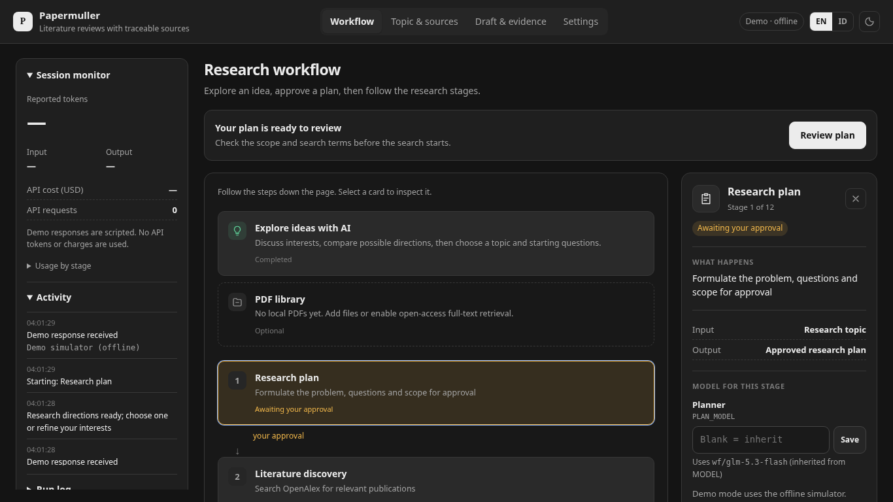
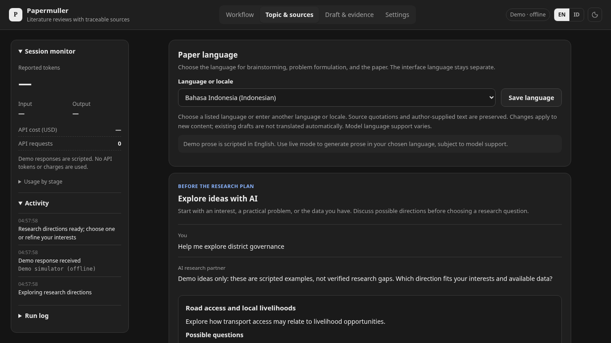

# Papermuller

Papermuller is a local research and writing app for finding literature, reading
available paper text, drafting a review, and tracing claims back to source
passages. It runs in your browser with a Python server on your computer.

AI can draft the surrounding sections of a working paper. **Methods and Results
come from the researcher**, and a final export requires both the review checks
and the saved researcher checklist. These checks do not certify scientific accuracy
or publication readiness.



[Windows setup](#windows) · [Paper language](#choose-the-paper-language) ·
[Full-text reading](#read-selected-papers-in-full-text) ·
[Outputs](#outputs-and-final-release) · [Tests](#development-and-validation)

## What it does

- Search OpenAlex with publication-year, work-type, open-access, and citation filters.
- Match DOI/title metadata against Crossref and select relevant articles.
- Use uploaded PDFs or retrieve available open-access PDFs for selected papers.
- Read extracted PDF text in page-labelled chunks and record processing coverage.
- Build a source matrix, literature review, claim audit, and evidence ledger.
- Draft a working paper with localized headings and a configurable writing language.
- Use WFLabs, OpenRouter, or another HTTPS OpenAI-compatible AI gateway, with per-stage models.
- Export Markdown, Word, BibTeX metadata, editorial diagnostics, and a research ZIP.

## Install and run

**Requirements:** Python 3.11 or newer. Installing packages needs Internet access.
Live AI and literature search also need Internet access; demo mode runs offline
once packages are installed. You do not need Node.js or Codex CLI to run the app.

[Download the latest source ZIP](https://github.com/ajoedya/papermuller/archive/refs/heads/main.zip),
or clone the repository:

```sh
git clone https://github.com/ajoedya/papermuller.git
cd papermuller
```

### Windows

1. Install [Python 3.11 or newer](https://www.python.org/downloads/windows/) and
   enable **Add python.exe to PATH**.
2. Extract the entire ZIP, or open the cloned folder. The working folder contains
   `app.py`, `requirements.txt`, `Setup.bat`, and `Start.bat`.
3. Double-click **Setup.bat** once, then **Start.bat**.

From PowerShell in that folder, the equivalent commands are:

```powershell
.\Setup.bat
.\Start.bat
```

Setup creates a local `.venv` and preserves an existing `.env`, `projects/`, and
`library/`. Keep the terminal window open while using the app. See the
[Windows setup and update guide](docs/LOCAL-LAPTOP.md) for more detail.

### macOS and Linux

From the project folder:

```sh
python3 -m venv .venv
.venv/bin/python -m pip install -r requirements.txt
[ -e .env ] || cp env.example .env
.venv/bin/python app.py
```

On your computer, open the address printed by the app, normally
`http://localhost:8765`. The server binds to `127.0.0.1`. Press Ctrl+C in the
terminal to stop it.

### Demo and live research

| Mode | What happens | Internet during a run |
| --- | --- | --- |
| Demo, the default | Fictional papers and scripted English AI responses | Not required |
| Live research | Your AI gateway, OpenAlex search, Crossref checks, and available OA PDFs | Required |
| Fully offline local AI | Ollama/LM Studio integration is not implemented | Not available |

To use live research, open **Settings**, choose your **AI provider**, enter its API
key, turn **Demo mode** off, and load its model list. Select an exact model ID, then
save and test the connections. Add an OpenAlex API key where needed. Setup preserves
existing `.env` settings; new copies use the WFLabs example in [env.example](env.example).

| Provider | `LLM_BASE_URL` | `LLM_API_KEY` | Model |
| --- | --- | --- | --- |
| WFLabs | `https://api.wflabs.ai.id/v1` | WFLabs key starting with `wf-` | Choose from its authenticated catalogue; guide example: `wf/glm-5.3-flash` |
| OpenRouter | `https://openrouter.ai/api/v1` | OpenRouter key starting with `sk-or-` | `openrouter/free` or an available catalogue ID |
| Other compatible gateway | Its HTTPS API base URL | A key from that gateway | An ID from that gateway |

WFLabs requires `Authorization: Bearer` for both `/models` and `/chat/completions`.
The app adds those paths automatically: enter only the base URL ending in `/v1`.
**Load model list from provider** uses the URL and key currently in the form,
including unsaved edits. **Test connections** saves the visible settings first.
When changing the endpoint, enter a key for the new endpoint. A legacy
`OPENROUTER_API_KEY` remains supported for OpenRouter only.

A `401` means the gateway rejected authentication: confirm the base URL, use a key
issued by that gateway, and check that it is active. WFLabs `wf/…` model IDs do not
work on OpenRouter. A `403` can indicate an inactive key or denied model access;
`429` can indicate quota, rate, or balance limits. The PDF guide's example model
does not guarantee access in your account. Models without catalogue pricing are
not assumed free. Review pricing before live runs; `openrouter/auto` may cost.

## Research workflow

Start under **Topic & sources**. Enter your topic, adjust research settings, and
add PDFs if you have them. Generate a plan, review its questions and scope, and
approve it before the search proceeds.

| Stage | What happens |
| --- | --- |
| 1. Research plan | Propose questions, scope, and search terms for researcher approval. |
| 2. Literature discovery | Search OpenAlex using the selected filters. |
| 3. Metadata & PDFs | Match DOI/title metadata and locate existing PDF sources. |
| 4. Source selection | Select articles relevant to the approved questions. |
| 5. Evidence extraction | Retrieve available OA PDFs, process extracted text, and record source/page evidence. |
| 6. Literature synthesis | Organize themes and gaps from the source matrix. |
| 7. Draft writing | Write or revise the literature review. |
| 8. Citation & claim audit | Check source IDs and assess paragraph support. |
| 9. Critical review | Score the draft and flag methodological concerns. |
| 10. Full paper draft | Draft title, abstract, introduction, discussion, and conclusion around the review. |
| 11. Final paper review | Check the assembled paper and revise within the configured limit. |
| 12. Export & review | Save research artifacts for researcher inspection and possible final release. |

Select a workflow node to inspect its inputs, outputs, model settings, and activity.
Revision cycles can revisit stages 7–9 and 10–11. Tokens and costs appear only when
reported by the provider; missing values do not mean a request was free.

## Choose the paper language

Under **Topic & sources → Research settings → Paper language**, choose a suggestion
or type another language or locale, such as:

- `English`, `English (UK)`, or `Indonesian`
- `French`, `Spanish`, or `Portuguese (Brazil)`
- `Arabic`, `日本語`, `Chinese (Traditional)`, or another language your model supports



The writing language is separate from the **EN/ID interface switch**. Custom values
survive reloads and UI-language changes. The setting is passed to planning,
synthesis, literature-review writing, and full-paper drafting. Common languages
have built-in heading labels; the drafting model can supply labels for others.
Word exports retain Unicode text and language metadata.

Source titles, quotations, citation IDs, numbers, and author-supplied Methods/Results
remain unchanged. Provide your own sections in the target language if you want
them to match. Discovery keywords are separately editable; the planner suggests
English search terms for coverage. Provisional workflow annotations may remain
English. Demo prose is scripted English, not a translation test.

Length and evidence checks account for unspaced scripts such as Chinese/Japanese.
Language quality still depends on the selected model and human review; Word
rendering depends on fonts and the editor.

## Read selected papers in full text

Papermuller first uses an uploaded or cached PDF. In live mode, automatic retrieval
then tries up to three PDF locations explicitly marked open access by OpenAlex.
It does not bypass logins or paywalls. Automatically downloaded PDFs must match
the selected DOI or title in their first pages; this is a heuristic identity check.

The evidence model receives **all available extracted PDF text in page-labelled
chunks**, including the final chunk. Grounded notes are combined into a source
summary. Later writing and auditing use summaries and selected source passages;
every PDF is not sent again in every prompt. Chunked reading can use substantially
more model calls than abstract-only processing.

| Setting | Behavior |
| --- | --- |
| `FETCH_FULLTEXT=true` | Try OA PDF retrieval for selected papers; uploaded/cached PDFs take priority. |
| `REQUIRE_FULLTEXT=false` | Allow explicit abstract-only fallback, with a reason. |
| `REQUIRE_FULLTEXT=true` | Stop before drafting if a selected paper lacks usable full text. |

**Draft & evidence → Full-text access & reading** shows access status, text/PDF page
counts, and processed/total chunks. Failed model calls leave reading incomplete.
Demo mode performs no PDF downloads and marks model reading as simulated.

Limits are **12 MB, 150 pages, and 900,000 extracted characters per PDF**. Pages are
not silently shortened. Scans, figures, and tables without extractable text need
separate OCR or visual review. A readable file or matching quote does not prove
that an interpretation is scientifically justified.

See [the full-text implementation guide](docs/FULLTEXT.md) for provenance,
networking, and coverage details.

## Research settings and models

Research settings live under **Topic & sources → Research settings** and in `.env`.
Each run records its search filters in `2_search_settings.json`.

| Setting | Purpose |
| --- | --- |
| `FROM_YEAR`, `TO_YEAR` | Inclusive publication-year window; blank end year defaults to the current year. |
| `WORK_TYPE` | `any`, `article`, `review`, or `article_review`. |
| `OPEN_ACCESS_ONLY`, `MIN_CITATIONS` | Open-access and citation-count filters. |
| `CANDIDATES`, `MAX_PAPERS`, `MIN_VERIFIED` | Candidate limit, selection limit, and minimum usable sources. |
| `REVISION_ROUNDS`, `TARGET_SCORE` | Revision limit and AI review threshold. |
| `LANGUAGE` | Paper language or locale, independent of the interface language. |
| `FETCH_FULLTEXT`, `REQUIRE_FULLTEXT` | Automatic PDF retrieval and strict full-text requirement. |

Set models under **Settings → AI models** or by selecting an AI stage in the
workflow. Comma-separated model IDs provide fallbacks: OpenRouter handles its
fallback array; other gateways try the configured IDs in order after an unknown
model or exhausted transient retries. Authentication failures stop immediately.
Blank stage settings inherit
from the following chain:

| Setting | Stage | Fallback |
| --- | --- | --- |
| `PLAN_MODEL` | Research plan | `MODEL` |
| `SCREEN_MODEL` | Source selection | `MODEL` |
| `EVIDENCE_MODEL` | Evidence extraction | `MODEL` |
| `OUTLINE_MODEL` | Literature synthesis | `WRITER_MODEL`, then `MODEL` |
| `WRITER_MODEL` | Draft writing | `MODEL` |
| `VERIFIER_MODEL` | Citation & claim audit | `MODEL` |
| `REVIEW_MODEL` | Critical review | `MODEL` |
| `REDTEAM_MODEL` | Challenge pass | `REVIEW_MODEL`, then `MODEL` |
| `PAPER_MODEL` | Full paper draft | `WRITER_MODEL`, then `MODEL` |
| `PAPER_REVIEW_MODEL` | Final paper review | `REVIEW_MODEL`, then `MODEL` |

**Load model list from provider** provides catalogue suggestions. Configured and
provider-reported model names are shown separately when available. Separate passes
can use the same model and are not independent scientific validation.

## Outputs and final release

Runs save files in `projects/<timestamp>/`. Uploaded/downloaded PDFs and extracted
text are cached in `library/`. Available outputs depend on how far the run completes.

| File | Contents |
| --- | --- |
| `4_literature_matrix.csv` | Extracted methods, findings, limitations, and source quotes. |
| `4_source_manifest.json` | Source access, identity/provenance, page counts, and reading status. |
| `4_fulltext_reading.json` | Per-chunk coverage and grounded notes. |
| `7_final_draft.md` | Selected literature-review draft and references; inspect its provisional status. |
| `7_final_evidence_audit.json` | Paragraph-level literature-review audit. |
| `8_manuscript_working.md` | Working manuscript scaffold. |
| `8_evidence_ledger.csv` | Traceable evidence entries, when generated. |
| `8_human_verification.json` | Saved researcher checklist. |
| `9_paper_draft.md` / `.docx` | Assembled paper with a draft/review banner. |
| `9_paper_review.json` | Review scores, deterministic checks, and completion status. |
| `9_paper_final.md` / `.docx` | Final export, created only after release requirements pass. |
| `9_editorial_report.json` | Local editorial findings with file and line references. |
| `9_references.bib` | Metadata-only BibTeX export using P-number source keys. |

To release a final paper, both author Methods/Results must be filled, the AI and
literature-review gates must pass, and the saved checklist must cover every required
source and global review item. Completion placeholders block release. Earlier saved
runs without the new completion metadata may need regeneration. “Final” records the
app's release conditions, not journal acceptance or independent verification.

**Editorial checks** flag selected writing patterns, heading gaps, unknown citation
IDs, and incomplete sections. They suggest changes without rewriting your text and
are not an AI-authorship detector. BibTeX author display strings may be incomplete;
verify publication details before submission.

**Download research bundle (ZIP)** packages current numbered Markdown, Word, CSV,
JSON, and BibTeX outputs. It excludes `.env`, logs, original PDFs, and symlinks.
The archive retains the run's draft/release state.

## Updates and troubleshooting

For a Git checkout without unfinished local changes:

```sh
git pull --ff-only origin main
```

Then rerun setup to refresh packages. A folder extracted from GitHub's ZIP cannot
be updated with `git pull`: extract a new ZIP and carefully transfer your `.env`,
`projects/`, and `library/`. Keep the old folder until the transfer is verified.
Create a new `.venv` rather than copying one between folders or operating systems.

On Windows, if setup reports missing `pip` metadata, close the app and rename the
virtual environment before rerunning setup:

```powershell
Rename-Item -Path ".venv" -NewName (".venv-backup-" + (Get-Date -Format "yyyyMMdd-HHmmss"))
.\Setup.bat
```

This preserves the old environment as a backup and leaves settings/research files
in place. Run commands from the project folder, not `C:\Windows\System32`.

Live use needs HTTPS access to your selected AI gateway (`api.wflabs.ai.id`,
`openrouter.ai`, or your configured host), `api.openalex.org`,
`api.crossref.org`, and the selected PDF hosts/redirect destinations. Restricted
networks may need those hosts allowed. Literature-service authorization, quota,
and connection failures are reported as unavailable lookups, not missing papers.

## Development and validation

Install test dependencies into the virtual environment and run:

```sh
python -m pip install -r requirements-dev.txt
python -m unittest discover -s tests -v
```

Use `.venv/bin/python` on macOS/Linux or `.venv\Scripts\python.exe` on Windows if
the virtual environment is not activated.

The latest implementation checks passed **80 Python tests**, plus Chromium checks
for the demo, custom-language persistence, full-text status, and incomplete-paper
release prevention. Router checks cover unsaved connection edits, WFLabs Bearer
authentication, provider-specific errors, saved/reloaded settings, and OpenRouter
and custom gateways. A real five-page PLOS PDF was fetched and extracted in the
full-text validation. Provider calls are mocked in the regression suite; live
WFLabs account access, multilingual model quality, and native Windows launcher
execution remain unverified.

The app uses Python's standard-library HTTP server with a local HTML/JavaScript
interface. Runtime dependencies are pypdf, python-docx, and fontTools. Extracted PDF
text has a bounded revision-aware cache, and the results API sends reading counters
rather than all chunk notes; complete notes remain downloadable.

## Current limits

- Search coverage is capped and Crossref does not cover every DOI registration agency.
- OCR, visual understanding, and a full Markdown/Word typesetting engine are not included.
- Active run state is process-local; saved folders cannot yet be reopened/resumed through the UI after a restart.
- There is no enforced run-cost budget. Long PDFs and revision cycles can multiply API calls.
- Full-paper claim support still needs researcher review beyond valid citation IDs and model scores.
- `.env` contains plaintext local credentials. Keep it, source PDFs, and research data out of public commits.

## Documentation and credits

- [Laptop setup and updates](docs/LOCAL-LAPTOP.md)
- [Full-text access and coverage](docs/FULLTEXT.md)
- [Optimization review and remaining priorities](docs/OPTIMIZATION-REVIEW.md)
- [MenulisCep4t comparison and adoption](docs/MENULISCEPAT-ADOPTION.md)
- [Changelog](CHANGELOG.md)

Document inspection and packaging ideas were informed by
[MenulisCep4t](https://github.com/FRCHN-GSTN/MenulisCep4t); Papermuller's integration
uses an original Python implementation. The comparison document records the
reviewed sources and scope.

## License

[MIT](LICENSE).
