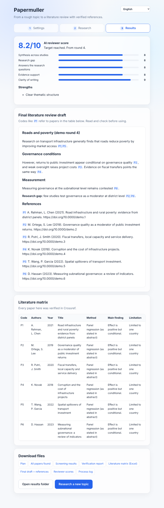
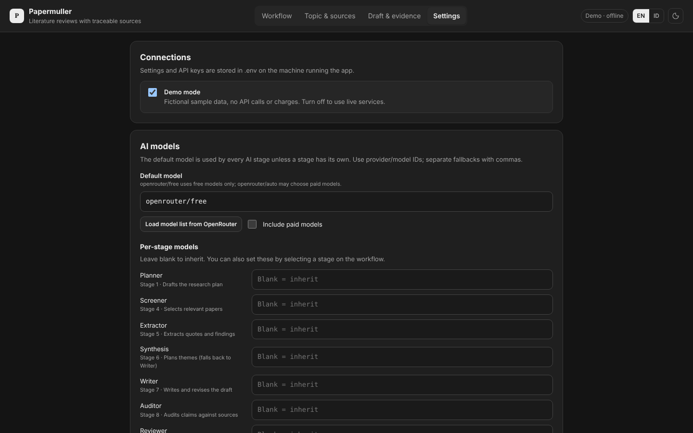
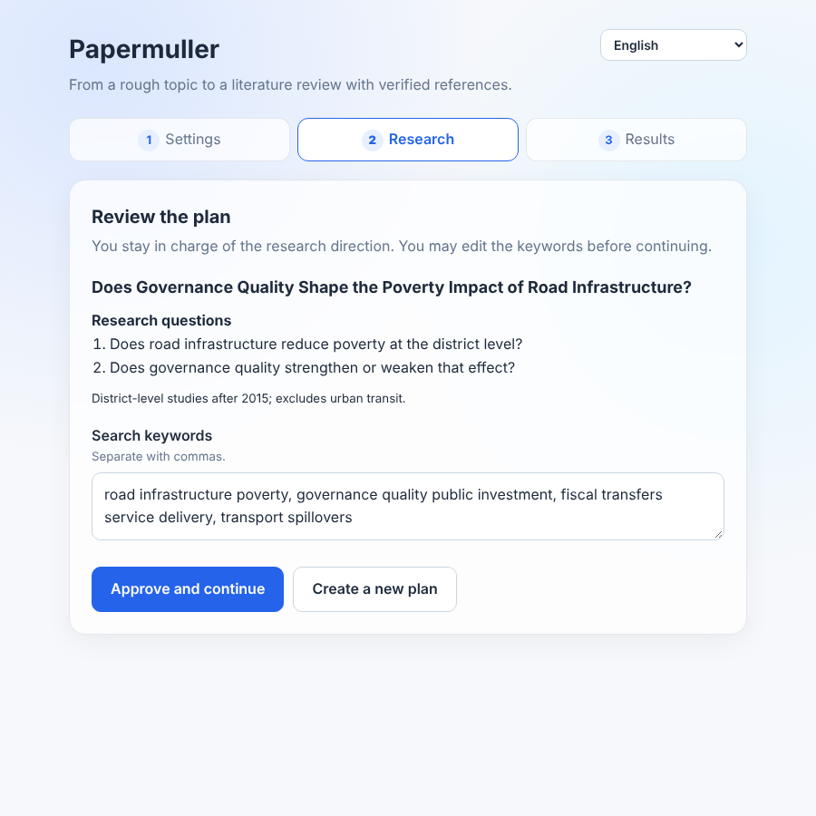

# Research Harness

A small, beginner-friendly AI research assistant that turns a rough topic into a
**literature review draft whose references are verified to exist**.

It runs on your own computer, needs **no extra Python packages**, and can work
entirely on **free AI models** through [OpenRouter](https://openrouter.ai).
Papers come from [OpenAlex](https://openalex.org) and are checked against
[Crossref](https://www.crossref.org), the official DOI registry.



> The interface is available in **English** and **Bahasa Indonesia** (switch at the top right).
> Drafts can be written in 12 languages.
---

## Why this exists

AI chatbots are good writers but unreliable researchers: they often invent
references. This project wraps the AI in a **harness**, a manager program that
runs the AI step by step, gives it real tools, and checks its work with plain
code before moving on. The AI may only cite papers that a real database confirmed.

## Features

- **Verified references only.** Every paper is checked in Crossref, and code (not AI)
  rejects any draft that cites something outside the verified list.
- **Human in control.** You approve the research plan and keywords before anything runs.
- **Relevance screening.** From up to 30 verified candidates, the AI keeps the 12 most
  relevant to your research questions.
- **Literature matrix.** Method, main finding, limitation and relevance for each paper,
  exported as a CSV that opens in Excel.
- **Outline first, then write.** The review is organised by themes, not paper by paper.
- **Rubric-based reviewer with a target score.** A reviewer AI scores 5 criteria;
  the final score is computed by code. Drafts are revised until they reach your
  target (default 8/10, max 4 rounds). The best draft is always kept.
- **Reference list included** in the final draft.
- **Quota friendly.** About 10 to 15 AI requests per run; automatic retries and backup models.
- **Demo mode.** Try the full flow with fictional data, free and offline.

## How it works

```
 Your topic
    |
 [1] PLAN        AI drafts title, research questions, keywords
    |
 >> YOU APPROVE  (edit keywords if needed)
    |
 [2] SEARCH      OpenAlex, most relevant results from every keyword
 [3] VERIFY      Crossref confirms each DOI          <- gate: enough real papers?
     SCREEN      AI keeps only papers that answer the research questions
 [4] MATRIX      AI summarises each paper (from its abstract only)
 [5] OUTLINE     AI plans themes and the research gap
     DRAFT       AI writes, citing [P1], [P2]...
     CITE CHECK  code checks every citation is verified   <- gate
 [6] REVIEW      reviewer scores 5 criteria               <- gate: target reached?
     (if not, the reviewer's fixes go back to DRAFT, up to 4 rounds)
    |
 FINAL DRAFT + REFERENCES   saved in projects/<date_time>/
```

| Part | File | Role |
|---|---|---|
| Manager | `harness.py` | Terminal version: order of work, approval, logging |
| Web interface | `app.py`, `ui.html` | Local web page for non-technical users |
| Workers | `stages.py` | One function per stage, with plain-English prompts you can edit |
| Brain | `llm.py` | Talks to OpenRouter, with retries and backup models |
| Hands | `tools.py` | OpenAlex search and Crossref verification |
| Practice kit | `demo_data.py` | Fictional answers for demo mode |
| Translations | `i18n.py`, `ui.html` | Messages in English and Indonesian |
| Settings | `env.example` → `.env` | Keys, models, language, quality rules |

## Quick start (Windows, no terminal)

1. Install **Python 3.11+** from [python.org](https://www.python.org/downloads/) and tick
   **"Add Python to PATH"** during installation.
2. Download this repository (green **Code** button → **Download ZIP**) and unzip it.
3. Double-click **`Start.bat`**. A black window opens and your browser shows the app
   at `http://localhost:8765`. Keep the black window open while you use it.
4. **Settings:** leave *Demo mode* ticked for a first try, or untick it and paste your keys
   (see below). Click **Save settings**, then **Check connections**.
5. **Research:** type a topic, click **Create research plan**, review it,
   then **Approve and continue**.
6. **Results:** read the score, final draft and matrix, and download the files.

| Settings | Plan approval |
|---|---|
|  |  |

## Getting the keys (both free)

| Key | Where | Notes |
|---|---|---|
| OpenRouter | [openrouter.ai](https://openrouter.ai) → Keys → Create Key | Starts with `sk-or-`. Set a credit limit on the key. |
| OpenAlex | [openalex.org](https://openalex.org) → sign up → `openalex.org/settings/api` | Without it you get a very small daily budget. |

**Free model quota:** OpenRouter allows 50 free-model requests per day, or 1,000 per day
after a one-time purchase of 10 credits. In OpenRouter **Settings → Privacy**, the switch
for free endpoints must allow providers that may train on prompts, or most free models
return error 404. Do not send confidential data through free models.

## Terminal version

```bash
cp env.example .env          # Windows: copy env.example .env
python harness.py "your research topic"
```

## Configuration (`.env`)

| Setting | Default | Meaning |
|---|---|---|
| `DEMO_MODE` | `true` | `true` = fictional data, free and offline |
| `OPENROUTER_API_KEY` | | Your OpenRouter key |
| `MODEL` | 3 free models | One model or several separated by commas (backups) |
| `REVIEW_MODEL` | empty | Optional different model for the reviewer |
| `LANGUAGE` | `English` | Draft language, e.g. `Indonesian`, `Spanish` |
| `UI_LANGUAGE` | `en` | Interface and log language: `en` or `id` |
| `TARGET_SCORE` | `8` | Reviewer average score a draft must reach |
| `REVISION_ROUNDS` | `3` | Extra revision rounds after the first draft |
| `CANDIDATES` / `MAX_PAPERS` | `30` / `12` | Papers verified / kept after screening |
| `MIN_VERIFIED` | `5` | Stop if fewer relevant, verified papers |
| `FROM_YEAR` | `2015` | Earliest publication year |
| `OPENALEX_API_KEY`, `EMAIL` | | OpenAlex access |
| `IGNORE_PROVIDERS` | empty | Providers to skip if one keeps failing, e.g. `Nvidia` |

## Output files

Each run gets its own folder in `projects/` (ignored by git).

| File | Contents |
|---|---|
| `7_final_draft.md` | Best-scoring draft with reference list |
| `7_final_review.json` | Rubric scores, strengths, suggested fixes |
| `4_literature_matrix.csv` | Literature matrix (opens in Excel) |
| `3_verification_report.csv`, `3_screening.json` | Which papers passed and why |
| `5_outline.json`, `5_draft_v*.md`, `6_review_v*.json` | Every intermediate step |
| `log.txt` | Full log of the run |

## Troubleshooting

| Message | Fix |
|---|---|
| `error 404 ... Provider returned error` | That provider is down. Use backup models or set `IGNORE_PROVIDERS`. |
| `error 404` on every free model | Check OpenRouter privacy settings (see above). |
| `free-models-per-day` | Daily free quota used up. Wait, or buy 10 credits once. |
| `Server said 400/429` from OpenAlex | Check your OpenAlex key or daily budget. |
| `Expected JSON but got...` | The model is too weak for structured output. Try a larger one. |

## Limitations and responsible use

- It reads **abstracts only**, not full texts, so summaries can be shallow.
- It writes the **literature review section**, not a full paper.
- The reviewer is an AI; a score of 8/10 is a useful signal, not a guarantee of quality.
- **You are the author.** Read every source you cite, check every claim, and follow your
  institution's and journal's rules on disclosing AI assistance.

## Security

- Your keys live only in `.env`, which `.gitignore` keeps out of the repository.
- The web app listens on `127.0.0.1` only, so it is not reachable from other computers.
- If you ever commit a key by mistake, delete that key in OpenRouter/OpenAlex immediately
  and create a new one; removing the file from git is not enough.

## Adding a language

1. In `ui.html`, copy the `en` block inside `I18N`, change its key (e.g. `ms`), translate the text,
   and add an `<option>` to the language menu.
2. In `i18n.py`, copy the `en` block in `MESSAGES` the same way.

## License

[MIT](LICENSE)
